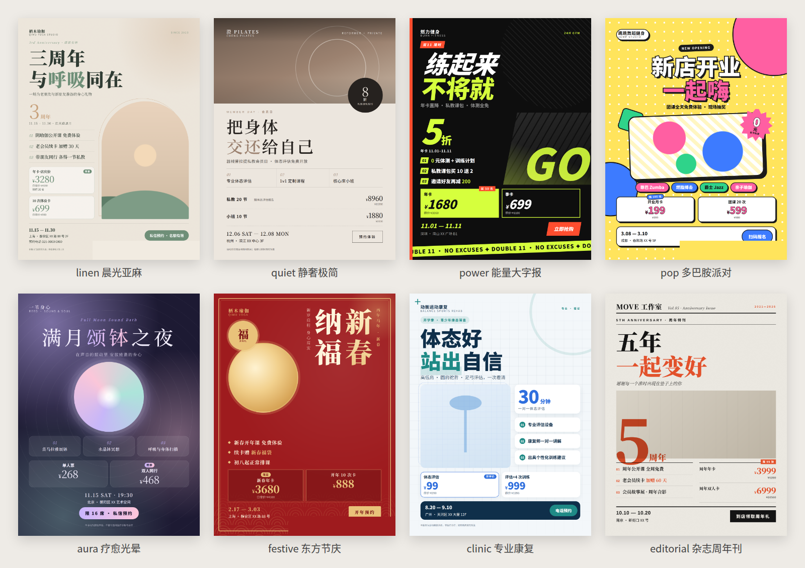
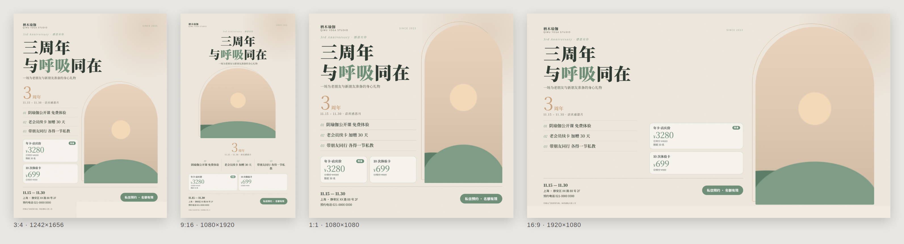

# vincent-studio-poster

> 工作室活动海报 **出图 Skill** · 瑜伽 / 健身 / 普拉提 / 运动康复 / 心身灵 / 音乐疗愈 · 8 种行业风格 · 一次输出 3:4、9:16、1:1、16:9 四种规格 PNG

告诉它你的活动（或者只说“中秋想做个活动”），它会帮你策划方案、提炼海报文案、推荐风格，然后**直接生成可发布的海报图片**。文字由 HTML 精确排版、Chrome 截图，中文、价格、日期、Logo、二维码**零错字**——不会出现生图模型常见的乱码字。



- [能做什么](#能做什么)
- [快速开始](#快速开始)
- [安装](#安装)
- [使用方法](#使用方法)
- [8 种风格](#8-种风格)
- [四种规格](#四种规格)
- [手动渲染（不经过 AI）](#手动渲染不经过-ai)
- [常见问题](#常见问题)

## 能做什么

| 你提供 | 它会做 |
|---|---|
| **活动方案 / 文案** | 提炼四层文案（主标题 · 视觉大数字 · 3 条卖点 · 行动信息）→ 推荐风格 → 出图 |
| **方案 + 照片 / Logo / 二维码** | 同上，并根据 Logo 与照片的颜色校准海报配色 |
| **只有想法**（馆型、节日、目标） | 先给 3 套推广方案（稳妥型 / 爆发型 / 情感型），你确认后再出图 |

适用活动：店庆周年、开业、会员日、双11 / 618 大促、早鸟预售、工作坊招募、公开课、体态筛查，以及春节、元旦、妇女节、母亲节、520、世界瑜伽日、七夕、中秋、国庆、冬至、圣诞等节日。

**内置能力**

- **活动策划手册**：按“拉新 / 续费 / 预收 / 曝光 / 促活”目标给出机制与价格结构。
- **节日营销日历**：全年节点 + 文案角度 + 推荐风格。
- **馆型调性**：不同馆型的用词、配色、照片建议。
- **合规自检**：《广告法》绝对化用语、康复与疗愈类疗效用语、原价真实性等。
- **自动排版检测**：文字过多时自动缩放并提示精简，四个规格各自独立排版，不是简单缩放。
- **AI 生图提示词**：没有照片时，可生成无文字的底图提示词，出图后交给脚本排版。

## 快速开始

```bash
git clone https://github.com/wbin888/vincent-studio-poster.git ~/.claude/skills/vincent-studio-poster
```

重启 Claude Code，然后说：

```text
用 vincent-studio-poster 帮我做瑜伽馆三周年店庆海报，11.15–11.30，年卡 3280（原价 4680），四个规格都要。
```

## 安装

### 第 1 步：准备环境

| 需要 | 说明 |
|---|---|
| Python 3.8+ | 只用标准库，无需 `pip install` |
| Chrome / Chromium / Edge | 用于截图出 PNG；macOS、Windows 装了 Chrome 或 Edge 即可 |
| 中文字体 | macOS / Windows 自带；Linux 执行 `sudo apt install fonts-noto-cjk` |

### 第 2 步：放到对应工具的 skills 目录

本仓库根目录就是 skill 本身，直接克隆到 skills 目录即可：

| 工具 | 个人目录（所有项目可用） | 项目目录（仅当前项目） |
|---|---|---|
| Claude Code | `~/.claude/skills/` | `.claude/skills/` |
| OpenAI Codex CLI | `~/.codex/skills/` | `.codex/skills/` |
| GitHub Copilot CLI / Agent | `~/.copilot/skills/` | `.github/skills/` |
| 其他支持 Agent Skills 的工具 | `~/.agents/skills/` | `.agents/skills/` |

**macOS / Linux**（把 `~/.claude/skills` 换成上表中你的目录）：

```bash
mkdir -p ~/.claude/skills
git clone https://github.com/wbin888/vincent-studio-poster.git ~/.claude/skills/vincent-studio-poster
```

**Windows（PowerShell）**：

```powershell
New-Item -ItemType Directory -Force "$HOME\.claude\skills" | Out-Null
git clone https://github.com/wbin888/vincent-studio-poster.git "$HOME\.claude\skills\vincent-studio-poster"
```

**不用 Git**：打开本仓库，点 **Code → Download ZIP**，解压后把文件夹重命名为 `vincent-studio-poster`，放进上表的目录。

### 第 3 步：确认安装成功

```bash
python3 ~/.claude/skills/vincent-studio-poster/scripts/render_poster.py --doctor
```

输出里能看到 Chrome 路径和中文字体即可。然后**重启**工具（或开新会话），问一句“你能用哪些 skills？”，列表里出现 `vincent-studio-poster` 即安装成功。

### 更新 / 卸载

```bash
cd ~/.claude/skills/vincent-studio-poster && git pull   # 更新
rm -rf ~/.claude/skills/vincent-studio-poster           # 卸载
```

## 使用方法

### 调用

| 工具 | 方式 |
|---|---|
| Claude Code | 输入 `/vincent-studio-poster`，或直接描述需求 |
| Codex CLI | 输入 `$vincent-studio-poster`，或直接描述需求 |
| Copilot CLI | 直接描述需求，并提到 `vincent-studio-poster` |

### 示例

```text
用 vincent-studio-poster，普拉提馆 12 月会员日，私教 20 节 8960，小班 10 节 1880，帮我出海报。
```

```text
用 vincent-studio-poster，这是我们的 Logo 和老师照片，做一张双11 健身年卡 5 折的海报。
```

```text
用 vincent-studio-poster，我是颂钵工作室，中秋想做个活动，你先帮我出几个方案。
```

### 流程

1. **收集信息**：一次只问一个问题，用编号选项回复即可（馆型、活动目标、日期、优惠、素材……）。
2. **策划方案**（只有想法时）：给出 3 套方案，你选编号或提修改意见。
3. **提炼文案**：主标题、视觉大数字、3 条卖点、价格卡、行动信息，先请你确认价格和日期。
4. **推荐风格**：给出 Top 3 及理由，你选编号，或说“你定”。
5. **出图并自检**：生成四个规格，检查层级、遮挡、错字、拥挤、合规后再交付。

### 输出

```text
output/
├── 活动名_3x4.png    ← 小红书
├── 活动名_9x16.png   ← 抖音 / 朋友圈 / 视频号
├── 活动名_1x1.png    ← 社群 / 团购主图
├── 活动名_16x9.png   ← B 站 / 门店屏
├── 活动名_sheet.png  ← 四规格总览
└── *.html            ← 可编辑源文件
```

满意后还可以让它改文案、换风格或配色，或生成朋友圈文案与社群通知。

## 8 种风格

| 风格 | 气质 | 最适合 |
|---|---|---|
| `linen` 晨光亚麻 | 燕麦米白 + 鼠尾草绿、拱门照片、宋体标题 | 瑜伽、冥想、工作坊、店庆 |
| `quiet` 静奢极简 | 大幅出血照片、细线、菜单式价目 | 普拉提、高端私教、会员日 |
| `power` 能量大字报 | 黑底荧光绿、斜切黑白照片、滚动横幅 | 健身房、双11 / 618、特训营 |
| `pop` 多巴胺派对 | 高饱和撞色、粗描边贴纸、爆炸贴 | 开业、店庆派对、团课、亲子 |
| `aura` 疗愈光晕 | 深紫极光、圆形光门、声波涟漪 | 音乐疗愈、颂钵、满月冥想、心身灵 |
| `festive` 东方节庆 | 双金框、竖排书法标题、月门圆窗 | 春节、元旦、中秋、国庆、端午 |
| `clinic` 专业康复 | 冰蓝网格、数据卡、白卡片 | 运动康复、体态筛查、产后修复 |
| `editorial` 杂志周年刊 | 杂志报头、巨型数字叠印 | 周年庆、品牌升级、年度回顾 |

变体：`festive` 有 `red` / `moon` / `jade`；`pop` 有 `sunny` / `berry` / `mint`；`aura` 有 `night` / `dawn`。所有风格都可以用 Logo 或品牌色覆盖配色。

## 四种规格

| 比例 | 像素 | 主要用途 |
|---|---|---|
| 3:4 | 1242 × 1656 | 小红书、朋友圈单图、大众点评 |
| 9:16 | 1080 × 1920 | 抖音、视频号、朋友圈长图、电梯屏 |
| 1:1 | 1080 × 1080 | 朋友圈九宫格、社群、团购主图 |
| 16:9 | 1920 × 1080 | B 站封面、公众号首图、门店电视 |

同一活动的四个规格共用一套风格、配色与文案，各自独立排版：



需要印刷或大屏高清图时加 `--scale 2`（2 倍像素）。

## 手动渲染（不经过 AI）

海报由一个 JSON 描述，可以自己修改后直接渲染：

```bash
cd ~/.claude/skills/vincent-studio-poster
python3 scripts/render_poster.py examples/yoga-anniversary.json --sheet          # 四规格 + 总览
python3 scripts/render_poster.py examples/yoga-anniversary.json --style aura     # 换风格对比
python3 scripts/render_poster.py examples/yoga-anniversary.json --ratios 3:4     # 只出 3:4
python3 scripts/render_poster.py --list-styles
```

`examples/` 里有 8 个风格各一个完整示例；字段说明见 [`references/spec-schema.md`](references/spec-schema.md)。最小示例：

```json
{
  "style": "linen",
  "brand": { "name": "栖木瑜伽", "logo": "logo.png" },
  "title": "三周年\n与**呼吸**同在",
  "hero": { "value": "3", "unit": "周年" },
  "points": ["阴瑜伽公开课 免费体验", "老会员续卡 加赠 30 天", "带朋友同行 各得一节私教"],
  "offers": [{ "name": "年卡·店庆价", "price": "3280", "original": "日常价 ¥4680" }],
  "date": "11.15 — 11.30",
  "location": "上海 · 静安区 XX 路 88 号",
  "cta": "私信预约",
  "photo": "teacher.jpg"
}
```

## 目录结构

```text
vincent-studio-poster/
├── SKILL.md                 ← Skill 主流程
├── agents/openai.yaml
├── scripts/render_poster.py ← 渲染脚本（Python 标准库 + Chrome）
├── assets/base.css          ← 版式引擎
├── assets/styles/*.css      ← 8 种风格
├── examples/*.json          ← 8 个示例
├── references/              ← 策划手册、节日日历、馆型调性、合规、规格、字段、生图提示词
└── docs/                    ← README 预览图
```

## 常见问题

**提示“未找到 Chrome”？**
安装 Chrome 或 Edge；或设置环境变量 `CHROME_PATH` 指向浏览器程序；或加 `--html-only` 只生成 HTML，用浏览器打开后自行截图。

**中文显示成方块？**
Linux 需安装中文字体：`sudo apt install fonts-noto-cjk`。

**日志里出现 `POSTER_DENSE`？**
说明该规格内容太多、文字被明显缩小。减少卖点或价格卡，或用 spec 里的 `by_ratio` 为该规格单独删减内容。

**没有照片怎么办？**
每种风格都自带抽象插画占位，可以直接用；也可以让它给出 AI 生图提示词，生成无文字的照片后再放进海报。

**商用字体授权？**
脚本使用本机系统字体。Linux 上的 Noto / 思源字体为开源可商用；macOS / Windows 自带字体用于商业海报前，请自行确认授权。

**价格、文案合规吗？**
Skill 会按 `references/copy-compliance.md` 自检：禁用“最 / 第一 / 顶级”等绝对化用语、康复与疗愈类不承诺疗效、原价需真实。重大活动仍建议咨询专业人士。
